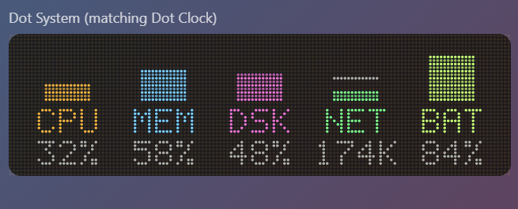
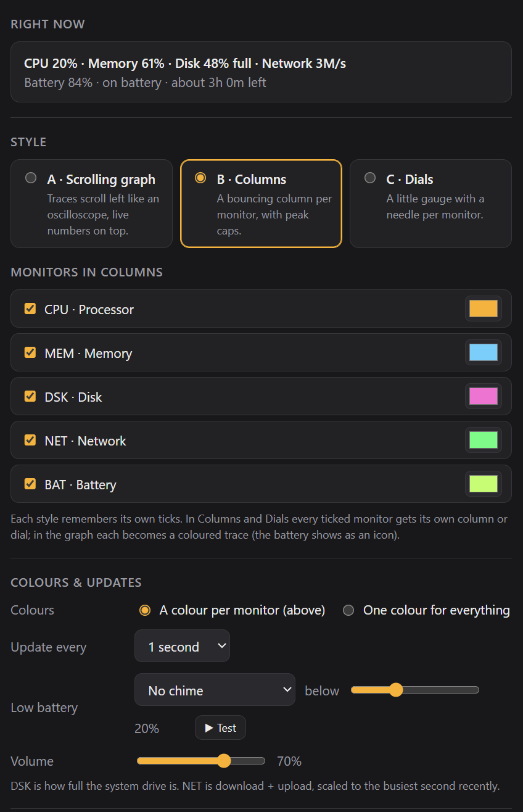

# Dot System

A dot-matrix system monitor for Windows and macOS, showing CPU, memory, disk, network and battery.

## What it does

**Three styles.** Pick one in settings:

| Style | What it looks like |
|---|---|
| A · Scrolling graph | Coloured traces scroll left like an oscilloscope, with live readings on top and a dot battery icon |
| B · Columns | A bouncing LED column per monitor, with falling peak caps and red when maxed out |
| C · Dials | A little gauge with a needle per monitor |

**Choose what's monitored.** Tick any of **CPU, MEM, DSK, NET, BAT**. Each style remembers its own ticks. In Columns and Dials, every ticked monitor gets its own column or dial, and the rest spread out to fill the width.

**What each monitor shows:**
- **CPU:** load across all cores.
- **MEM:** memory in use.
- **DSK:** how full the system drive is.
- **NET:** download plus upload, scaled to the busiest second recently.
- **BAT:** charge level, `CHG` while plugged in, and time remaining shown in settings. It turns red when low. On desktops with no battery it's hidden automatically.

**Settings also include:**
- **Colours:** one per monitor, or one colour for everything.
- **Update interval:** every 1, 2 or 5 seconds.
- **Low-battery chime:** set your own threshold, and pick from the same ten 8/16-bit chimes as the other apps.
- **"Right now" card:** shows every reading in words.
- **Matching Dot Clock:** same width, dot size and colours.

## How it works

- **Readings** come from the app's Rust side, using two libraries:
  - [`sysinfo`](https://crates.io/crates/sysinfo) for CPU, memory, disk and network
  - [`starship-battery`](https://crates.io/crates/starship-battery) for the battery

  Both work on Windows and macOS.
- **The display** uses the same dot-matrix renderer as the rest of the family.
- **Offline.** It never connects to the internet. Network figures are just your own traffic.

## Where it lives

The widget doesn't take up a spot on the taskbar (or the Dock on a Mac). It sits in the **system tray** (the menu bar on a Mac) instead. Left-click the tray icon to bring the widget forward, and right-click it to show or hide the widget, open settings, move the widget to the centre of the screen, or quit.

## Building it yourself

See [BUILDING.md](BUILDING.md). The installer is called `Dot System_1.1.0_x64_en-US.msi`.

## Check out the Singular Widgets

[Dot Calendar](https://github.com/slainbya-dotcom/dot-Calendar)
[Dot Clipboard](https://github.com/slainbya-dotcom/dot-clipboard)
[Dot Clock](https://github.com/slainbya-dotcom/dot-clock)
[Dot Deck](https://github.com/slainbya-dotcom/dot-deck)
[Dot Dice](https://github.com/slainbya-dotcom/dot-dice)
[Dot Focus](https://github.com/slainbya-dotcom/dot-focus)
[Dot Launcher](https://github.com/slainbya-dotcom/dot-launcher)
[Dot List](https://github.com/slainbya-dotcom/dot-list)
[Dot Planner](https://github.com/slainbya-dotcom/dot-planner)
[Dot Player](https://github.com/slainbya-dotcom/dot-player)
[Dot Reader](https://github.com/slainbya-dotcom/dot-reader)
[Dot Sun](https://github.com/slainbya-dotcom/dot-sun)
[Dot System](https://github.com/slainbya-dotcom/dot-system)
[Dot Ticker](https://github.com/slainbya-dotcom/dot-ticker)
[Dot Timer](https://github.com/slainbya-dotcom/dot-timer)
[Dot Visualiser](https://github.com/slainbya-dotcom/dot-visualiser)
[Dot Weather](https://github.com/slainbya-dotcom/dot-weather)